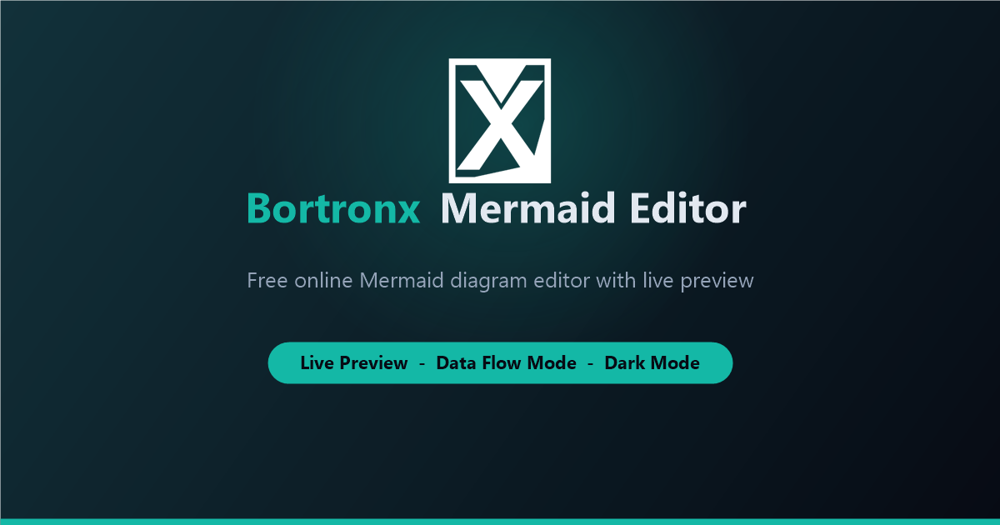
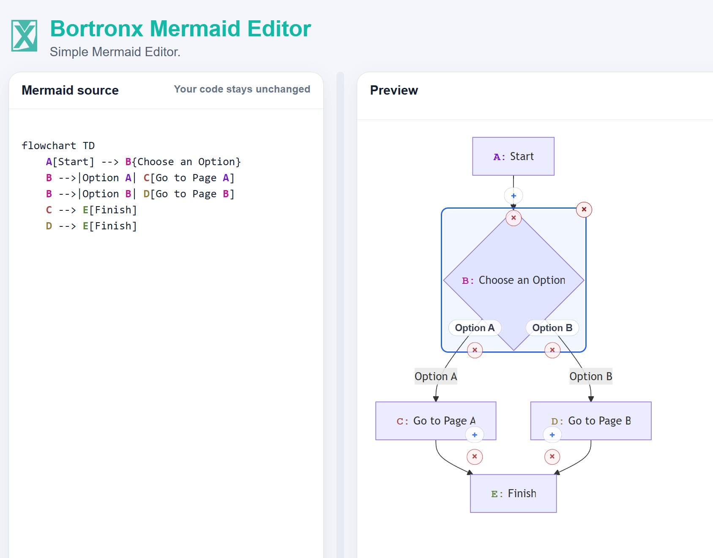

# Bortronx Mermaid Editor

[](https://mermaid.bortronx.com/)

## [Bortronx Mermaid Editor Demo](https://mermaid.bortronx.com/)

Bortronx Mermaid Editor is a Blazor-based Mermaid diagram editor with a live preview pane and a focused workflow for building standard Mermaid diagrams or data flow diagrams.

The repository contains:

- `Libraries/BortronxMermaidEditor`: a reusable Razor Class Library component.
- `src`: a Blazor WebAssembly app that hosts the editor.
- `Firebase/public`: the published static output, including the generated social preview image.
- `Desktop`: an optional, fully offline desktop wrapper (Windows and Linux).

## Features

- Live Mermaid source editing with immediate preview updates.
- Copy the exact Mermaid code using **Copy code** in the source panel header.
- Standard mode and Data Flow Diagram mode.
- Data flow helpers for entities, processes, data stores, flows, and legend management.
  The four addition buttons appear as a secondary bar directly below the Preview
  header. **Data Flow settings** at the right of that bar opens a separate dialog for
  loading the DFD template, editing legend definitions, and updating, inserting,
  removing, or copying the legend. Close the dialog with **Close** or Escape.
- Interactive preview controls including zoom, fullscreen, and diagram editing helpers.
- Undo and redo support.
- Light and dark theme toggle.
- Error console for Mermaid parsing issues.
- Copy a self-contained diagram link that restores the exact source and editor mode.
- Hover highlights individual nodes inside subgraphs; subgraphs highlight only over their own empty area.

The compact preview header groups variable names and control visibility
under **Display options** (initially collapsed). Node/subgraph actions
remain in the header; zoom, reset, and fullscreen actions sit along the bottom
beside the existing color palette on a solid panel background. **Hide controls**
also hides **+ Node**, **+ Subgraph**, Reset, and the footer divider; zoom and
fullscreen remain available. Fullscreen retains its own Reset control.
The Console starts collapsed and can be expanded using its chevron. Diagram errors
automatically expand it and highlight its header and log in red. A successful render
removes the highlight and restores its expanded/collapsed state from before the error,
while retaining the error history. **Clear** removes the log and highlight.
It can still be collapsed manually; another error reopens it.
Source editing and diagram interactions are unchanged.
Fullscreen shows only the diagram and zoom out, zoom in, Reset, and Exit fullscreen
controls. Preview headers, Data Flow tools, color palette, and editing overlays are
hidden until fullscreen is exited; their visibility settings are preserved.
On desktop, the collapsed Console and both editor panels fit within the viewport
without page scrolling. Expanding the Console adds scrollable space below the
panels without shrinking them; mobile retains the stacked, scrollable layout.
The web host disables desktop page scrolling while the Console is collapsed,
including overflow from third-party diagram tooltips. No content follows the Console.
Mermaid's generated syntax-error graphic is disabled, and temporary render containers
are cleaned up after failures. Errors stay in the existing Preview/Console reporting.
Copy buttons briefly display a checkmark and **Copied!** without shifting the
layout; failed copies display **Copy failed** with details in the button tooltip.
Contextual color-painting and subgraph-selection tips appear beside **Console**.
Display options closes when clicking outside its dropdown. Deleting a node, edge,
or subgraph in Preview removes its associated styles; surviving indexed arrow
styles are renumbered after edge removal.

Run source-deletion regression checks with `node --test Tests/editor-deletion.test.cjs`.
The website's **Mermaid Editor** title opens the guide in a modal window, dismissed
with **Close** or Escape.

## Share a diagram

Click **Copy diagram link** in the toolbar, then send the copied URL. Opening it
loads that snapshot of the Mermaid source, including whitespace, comments, labels,
styles, and Standard/Data Flow mode. Later edits do not change an already copied link.
Links also work when opened in an existing editor tab.

The versioned `#diagram=` URL fragment uses lossless zlib/DEFLATE compression and URL-safe
Base64. Tiny diagrams use uncompressed UTF-8 when that makes the payload shorter.
No diagram storage service or account is required, and the fragment is not sent to
the hosting server. Anyone with the link can decode its contents: it is not encrypted.
Do not share sensitive diagrams. A source-size limit of 1 MiB protects link loading;
large diagrams still produce long URLs and may exceed limits in browsers or messaging
apps, so there is no fixed short-link length guarantee.

To run share-format regression checks:

```bash
dotnet run --project Tests/DiagramLink.Tests/DiagramLink.Tests.csproj
```



## Run locally

```bash
dotnet run --project src/BlazorMermaidEditor.csproj
```

## Use the component

Add a project or package reference to `BortronxMermaidEditor`, then render the component in a Razor page:

```razor
<MermaidEditor />
```

## Search visibility and performance

The web host includes its introductory guide, usage instructions, and Mermaid examples
as static HTML in an information dialog outside Blazor's `#app` mount. The guide is
hidden until the **Mermaid Editor** title is pressed, keeping the editor on one screen.
The dialog content remains in the initial HTML, but opening it requires JavaScript.
Host-specific styling lives in `src/wwwroot/css/site.css` and is not bundled into the
reusable editor component.
The web host loads the editor stylesheet in its initial document to avoid displaying
an unstyled editor while the lazy JavaScript loader starts. Other component hosts
can still rely on the component's self-loading assets.

The homepage includes a canonical URL, description, social preview metadata, and
`WebApplication` structured data. `robots.txt` allows crawling and points to
`https://mermaid.bortronx.com/sitemap.xml`. Diagram fragments are snapshots of the
same page, not separate pages to add to the sitemap.

Use Google Search Console's `sc-domain:mermaid.bortronx.com` property to monitor
indexing and the submitted sitemap. Check mobile performance with
[PageSpeed Insights](https://pagespeed.web.dev/analysis?url=https%3A%2F%2Fmermaid.bortronx.com%2F&form_factor=mobile).
Lab measurements vary by run; a real-user Core Web Vitals verdict requires enough
field data. Metadata and sitemap submission do not guarantee rankings.

## Desktop app (offline)

The editor is also available as a standalone desktop app that runs **fully offline** — it
bundles the published web app and serves it locally, so no internet connection is required.

### Download

Grab the latest build from the [Releases page](https://github.com/Bortronx/BortronxMermaidEditor/releases):

- **Windows:** download `BortronxMermaidEditor-win-x64.exe` and double-click to run. No
  installation needed. On the first launch Windows SmartScreen may show a warning for the
  unsigned app — choose **More info → Run anyway**.
- **Linux:** download `BortronxMermaidEditor-linux-x64`, then:

  ```bash
  chmod +x BortronxMermaidEditor-linux-x64
  ./BortronxMermaidEditor-linux-x64
  ```

  Requires WebKitGTK (`libwebkit2gtk-4.1` / `4.0`), which ships with most desktop Linux
  distributions or installs from your package manager.

### Build locally

The desktop project lives entirely in `Desktop/` and is isolated from the web app — it only
consumes the web app's published output. To build it, publish the web app, copy its `wwwroot`
into `Desktop/wwwroot`, then publish the desktop app for your platform:

```bash
# 1) Publish the web app
dotnet publish src/BlazorMermaidEditor.csproj -c Release -o publish-web

# 2) Copy the published web output into the desktop bundle folder
#    Windows (PowerShell):
#      Remove-Item Desktop/wwwroot -Recurse -Force -ErrorAction SilentlyContinue
#      Copy-Item publish-web/wwwroot/* Desktop/wwwroot -Recurse -Force
#    Linux/macOS:
#      rm -rf Desktop/wwwroot && mkdir -p Desktop/wwwroot && cp -r publish-web/wwwroot/. Desktop/wwwroot/

# 3) Publish the self-contained desktop binary (use win-x64 or linux-x64)
dotnet publish Desktop/BortronxMermaidEditor.Desktop.csproj -c Release -r win-x64 -o publish-desktop
```

Releases are produced automatically by the `Release Desktop App` GitHub Actions workflow when
a version tag (for example `v1.0.0`) is pushed.

## License

This project is licensed under the MIT License. See [LICENSE](LICENSE).
